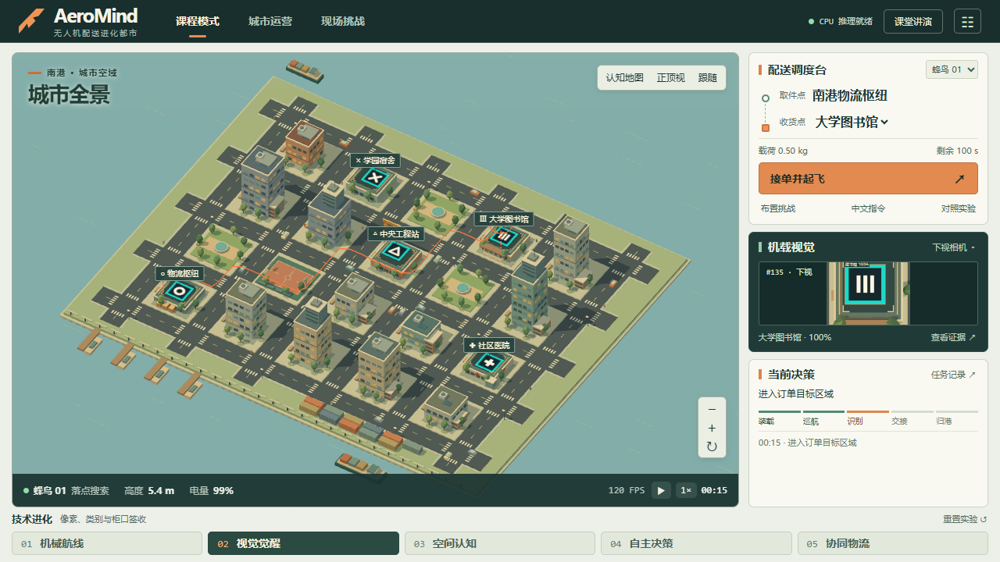

# AeroMind-2.5D · 无人机配送进化都市

在一座持续运转的微缩港城里，接单、观察无人机看到的画面、改变空域条件，再比较它如何完成配送。中文课堂模式可以在一台普通 Windows 核显电脑上离线运行。



## 启动课堂版

下载 Windows x64 单文件版，复制到课堂电脑后双击 `AeroMind.exe`。程序在本机启动静态服务，并使用现有的 Edge 或 Chrome 打开独立应用窗口。城市、模型和 WebAssembly 运行库均随 EXE 分发。只需支持 WebGL 2 的浏览器。关闭窗口后，本地服务会在心跳停止约三分钟后退出。[下载离线课堂版](https://github.com/JmCake/AeroMind-2.5D/releases/download/v1.0.0/AeroMind.exe)

选择底部**视觉觉醒**，选中**大学图书馆**，点击**接单并起飞**。右侧可切换实际的下视和航向相机。下视画面出现柜标时，打开**查看证据**，可以看到原始帧编号、模型、像素分割和耗时。柜台在标记通过复核且无人机落稳后签收，返航结束后在**任务记录**查看结果。

## 课堂操作

| 想观察的现象 | 操作 |
| --- | --- |
| 五阶段能力变化 | 选择机械航线、视觉觉醒、空间认知、自主决策或协同物流。章节、训练检查点和运行中的地图分别记录。 |
| 遮挡改变行动 | 在自主决策章安排“平台占用”，选择图书馆或点选城市位置，再接单。占用物实际遮挡标记。改变生效或持续时间，可以得到不同结局。 |
| 证据怎样形成地图 | 从第 3 章起打开认知地图，点击格子查看来源与观测时间，在证据面板切换飞行层、像素分割和局部深度点云。 |
| 对照两种算法 | 在第 4 章先安排一个尚未生效的事件，接单后打开对照实验保存起点。分别运行本章基线和完整配置，上一次航迹以紫色虚线显示。 |
| 多机共享与让行 | 第 5 章启用三架无人机。设置面板可以停用共享、加入延迟丢包或断开通信。观察预约到期后的等待、消息来源与订单记录。 |
| 输入自己的订单 | 中文指令采用离线结构化解析，支持目的地、避开地标、优先级、期限和占用时等待或返仓。目的地有歧义时可以选定。 |
| 连续讲演 | 点击右上角“课堂讲演”。七分钟流程依次安排订单、遮挡、同条件重演与三机调度。无人机的决策和任务结局在现场计算。 |

拖动城市旋转，滚轮缩放，V 在斜俯、顶视和机载主视角之间切换。空格暂停，速度键切换 0.5×、1×、2×。执行订单时按 M 接管或交还控制，WASD 平移，Q/E 升降。设置中可保存实验条件与模型选择。城市运营会持续生成订单。

## 感知、学习与控制

- **相机和识别。** Three.js 单独渲染北向下视透视相机，输出 192 × 144 RGBA，垂直视场 65°。Web Worker 对柜标边框做连通域分割，随后用两层卷积的 ONNX 网络判别五种柜标和干扰项，并关联相邻帧。每次最多一帧在途。相机采样、推理完成和控制采用分别计时。
- **定位和深度。** 前两章允许有噪声的模拟 GPS，第 3 章起以初始枢纽参考、量化的惯性增量、图像块匹配和柜标重观测更新估计。地标先验给出所在格。测距传感器模拟有限量程与噪声，局部深度采用 13 × 9 条视线，几何融合使用估计位姿。图像失去特征时，惯性估计会累积漂移。
- **导航和调度。** 城市采用三个高度层，A* 考虑格间代价、到达时间、机体净空、观测占据、通告和队友预约。局部控制对速度变化作阻尼平滑。动态距离的变化率参与制动和短时占用预测。主动配置在已观测的候选位置比较信息收益和移动代价。协作使用有时限的局部证据、柜台预约与分层进出港。
- **训练和评测。** 模型在 CPU 上用程序生成的印刷样本和游戏实际渲染的裁片训练，城市种子按训练、验证、测试分开。三个 ONNX 检查点各约 80 KB。独立训练的表格 Q 策略在等待、换视角与绕行之间选择，状态包含观测、订单紧迫度与队友可用性。设置面板可分别选择检查点和决策方法。
- **信息边界。** 工作线程接收像素、相机尺寸、时间、帧号和模型选择。主持人标签和航迹排除在推理画面之外。城市几何用于渲染、模拟测距、碰撞、柜台交接和独立评测。规划读取订单授权的目标区与通告、机载观测形成的地图和通信结果。包裹在指定静止柜台办理交接。
- **对照口径。** 同条件重演保存城市、外部随机流、任务队列、动力学、地图、预约和消息，并用保存的实际相机帧预热图像工作线程。各分支随后采集自己的画面。异步调度可以产生运行差异。能耗单位是游戏电量百分点，每步累计悬停时间、移动距离和爬升代价。

## 发行包实机验收

测试机为 Windows 11、Intel Core Ultra 5 125H、31.6 GiB 内存和 Intel Arc 核显。Edge 使用 WebGL 2，经 ANGLE 调用 Direct3D 11。性能测试使用 1280 × 720 的可见窗口，其中城市画布为 929 × 581。单机和三机分别预热后采样 24 秒。神经网络使用单线程 WebAssembly CPU 后端。

| 指标 | 单机 | 三机 |
| --- | ---: | ---: |
| 中位帧率 | 120.5 FPS | 120.5 FPS |
| 帧间隔 P95 | 8.6 ms | 8.6 ms |
| 单帧视觉处理 P95 | 0.9 ms | 1.0 ms |
| 相机采样至控制采用 P95 | 116.2 ms | 165.2 ms |

- **离线启动。** 通过默认入口启动的 EXE 在本机提供了与训练记录哈希一致的成熟模型。另开独立测试窗口时，2.36 秒内完成窗口和模型校验，关闭后本地进程在 189.27 秒自行退出。
- **标准订单。** 十个城市种子各派一单到图书馆，十单均签收归港，零碰撞。最长用时 31.7 秒，最大柜口误差 0.68 米。
- **独立感知测试。** 在四张额外的测试地图和四种天气中，五种柜标的 120 个可见样本全部检出，40 个遮挡样本均无误报。检测框平均交并比为 0.984。独立裁片测试集包含 1,412 张图，成熟、早期模型的分类准确率分别为 98.65% 和 16.43%。
- **同起点对照。** 限制下一航段的同一事件中，基线等待 16.0 秒，43.37 秒归港。主动配置走了更长的路，30.87 秒归港。重复运行主动配置得到相同的毫米量化航迹摘要。
- **多机协作。** 三架分别派往三个柜台，三单均归港，零碰撞，最小机间距 1.84 米。在两单同一受遮挡柜台的实验里，后到者在邻街等候，开启共享时队友响应五次协查，两单均签收归港。
- **连续课堂讲演。** 同一页面按 1× 连播十轮，总计 70 分 6.3 秒。十轮均完成，无页面异常和外部网络请求。七分钟截止时累计 97 单已签收归港，另外 3 单正处于归港阶段。已归档订单记录了 2 次碰撞。另一次十轮加速回归中，100 单均签收归港，记录了 10 次碰撞。

完整记录关联发行 EXE 的 SHA-256，包括每个订单的路径、电量、等待、定位误差和每轮讲演的结果。鼠标、键盘、存档和恢复通过自动化操作验证，课堂理解效果须由实际参加演示的同学评价。[读取验收数据](verification/results.json)

## 从源码运行

已验证的开发环境为 Node.js 24、TypeScript 5.9 和 Python 3.11。普通源码启动只使用 Python 标准库。

```powershell
npm ci
npm run build
python tools/launch.py
```

首次构建需要下载 npm 依赖。完成后可离线重复启动。模型权重已签入仓库。重新打包 Windows 版时，在 Python 3.11 虚拟环境安装 `Vision/requirements-build.txt`，执行 `tools/package.ps1`。输出位于 `artifacts/windows/AeroMind.exe`。

复训流程使用 CPU 版 PyTorch、OpenCV 和 NumPy 执行 `Vision/train.py`，再在装有 ONNX 与 ONNX Runtime 的环境执行 `Vision/export.py`。本次训练复用了电脑现有的 Python 3.10 和 PyTorch 2.9.1+cpu，导出、独立验证与打包使用 Python 3.11。训练记录保存了随机种子、样本数、曲线、测试混淆矩阵和权重 SHA-256。[模型记录](public/models/training.json)

`node tools/test.mjs dataset` 从实际三维城市重新采集按地图分组的图像裁片。`python Vision/policy.py` 重建调度策略表。

浏览器回归从真实本机静态服务启动，阻断外部请求，使用同一套渲染器、模型和控制器。

```powershell
node tools/test.mjs smoke
node tools/test.mjs perception
node tools/test.mjs standard
node tools/test.mjs scenarios
node tools/test.mjs interaction
node tools/test.mjs native --headed
node tools/test.mjs lecture
node tools/test.mjs lecture-live
```

`lecture` 以加速仿真时钟连续运行十轮，`lecture-live` 以 1× 实际播放速度连续运行十轮。原始测量保存在 `output/playwright/`。可设置 `AEROMIND_APP` 指向待验收的 EXE，以检验分发包。完整产品设计见 [PLAN.md](PLAN.md)，组件许可见 [第三方说明](THIRD_PARTY.md)。

在 Windows 上运行 `python tools/test-launch.py artifacts/windows/AeroMind.exe` 可检查双击启动所经过的应用窗口、内置模型与关闭后的自动退出。浏览器各项测试及启动测试完成后，执行 `node tools/summarize.mjs artifacts/windows/AeroMind.exe` 可由同一份 EXE 的测量生成发行验收记录。
